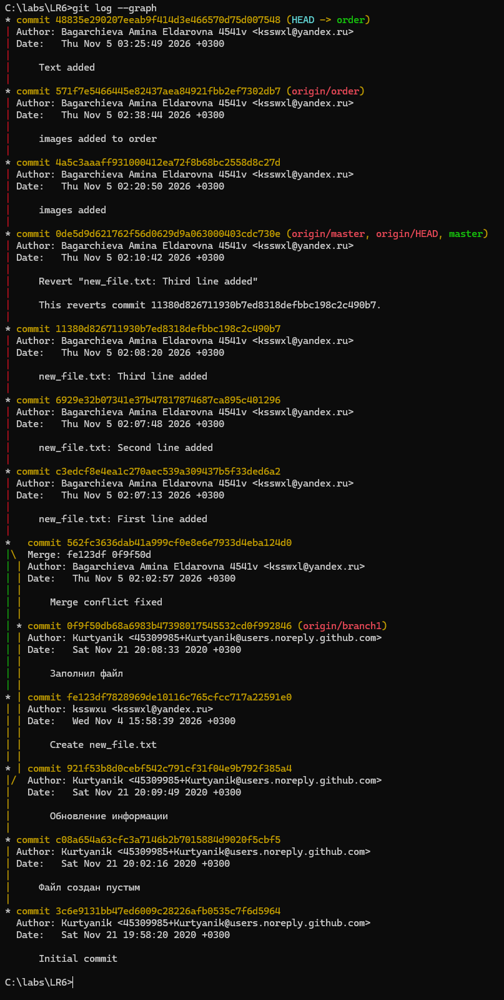

# LR6
Лабораторная работа №6

После копироваривания репозитория получаю историю всех изменений, сделанных в нем ранее:

Затем получаю последнее изменение ветки master:

Также получаю последнее изменение ветки branch1: 

После чего провожу слияние ветки branch1 и ветки master, получаю конфликт:

Открываю файл mergefile.txt, вызвавший конфликт:

Изменяю его, оставляя текст из обеих веток:

Затем провожу коммит и осуществляю слияние веток:

Удаляю ветку branch1:

Добавляю в файл new_file.txt строчку:

Делаю коммит:

Добавляю вторую строчку:

Делаю коммит:

Добавляю третью строчку:

Делаю коммит:

Провожу откат последнего коммита с помощью git revert, появляется:

Выхожу командой wq и возвращаюсь в консоль:

Итоговая история коммитов:
